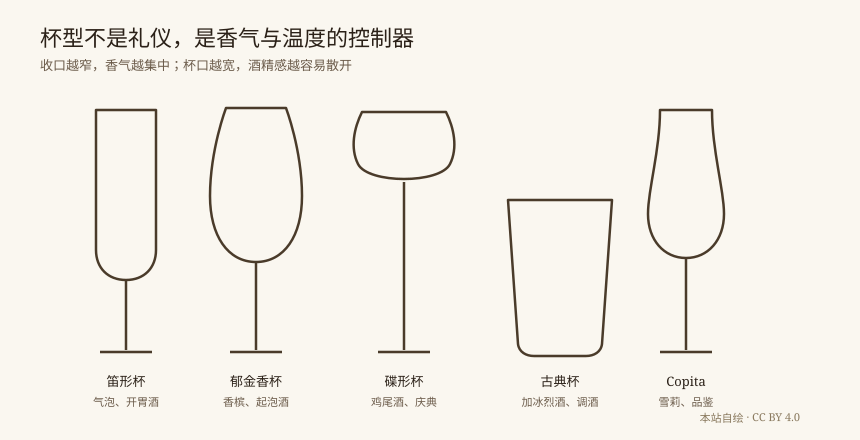

# 郁金香杯

郁金香杯（tulip glass）是一种杯腹较宽、向上收窄、杯口略收的杯子。它的轮廓像郁金香花苞：下部的杯腹有足够空间让酒液与香气展开，上部的杯口收拢，把香气引向鼻端。它既用于香槟与气泡酒，也用于啤酒，还被一些吧台用于香气优先的短饮。

图：常见杯型的轮廓与用途对照。杯口收窄集中香气，杯口放宽让酒精感散开。本站自绘，CC BY 4.0。

## 杯型定义

郁金香杯的核心特征是“宽腹收口”。杯身从杯脚向上扩展，达到最宽处后再向杯口收窄，形成一个柔和的弧线。杯口直径通常小于杯腹最宽处，这是它与直筒杯、笛杯最明显的区别。

它通常带杯梗，但也有一些无梗的啤酒杯款式。带梗款更适合香槟与短饮，手指可以捏住杯梗，减少手部传热；无梗款更接近日常啤酒杯，握持方式不同。杯身容量与高度差异很大，没有统一规格。

郁金香杯与笛杯、碟形杯并不是同一种杯的变体，而是不同的结构取向：笛杯优先气泡，碟形杯优先开放香气，郁金香杯则在两者之间取得折中。

## 形状如何影响香气与温度

宽杯腹提供较大的液面与香气挥发面积，让香气有空间展开；收窄的杯口把香气集中到杯口附近，闻香时更容易捕捉到层次。这种“先展开、再收拢”的结构，是郁金香杯最被看重的地方。

杯腹的宽度也让气泡有上升与回旋的空间，气泡不会像在极窄的笛杯中那样被限制在一条细线上。气泡仍然会逸出，但消散速度通常比碟形杯慢，又不像笛杯那样被极度延缓。

温度方面，杯腹较大意味着液面面积较大，酒液与空气接触更多，回温相对快；杯梗减少手部传热，但无法阻止环境温度的影响。容量较大的杯子装少量酒时，香气空间更大，温度也更容易受杯壁影响。

杯口收窄还有一个实际作用：饮用时酒液流向口腔的位置更集中，气泡感与香气更同步。对于香气复杂、气泡细腻的酒，这种结构比宽口杯更容易呈现层次。

## 容量与适用酒款

郁金香杯没有统一的容量标准，杯腹大小、杯口宽度与杯身高度差异明显。本页不给出固定容量数值，容量以具体产品为准。使用时应按自己的杯子调整倒酒量，避免倒得太满压缩香气空间。

适合郁金香杯的酒款包括香槟与[气泡酒](ref:sparkling)，尤其是希望同时感受香气与气泡的场合；也包括[啤酒](ref:beer)，许多啤酒杯型采用郁金香轮廓，以聚集麦芽与酒花香气。部分香气优先、不加冰的短饮也会使用郁金香杯，具体以配方与吧台习惯为准。

它不太适合需要大量冰块的饮品。杯腹虽宽，但杯口收窄，放入大冰块后难以搅拌，装饰也受限。需要长时间保冷的长饮，直身杯更合适。

同一款酒在不同大小的郁金香杯中表现不同。杯腹大、杯口窄的款式香气更集中；杯腹小、杯口宽的款式更接近普通酒杯。选择时应看自己更在意香气还是气泡。

## 材质与清洁

郁金香杯常见材质是玻璃与水晶玻璃。普通玻璃耐用、成本较低；水晶玻璃更薄、更透亮，但更易碎。杯身弧线较复杂，清洗时需要更仔细地冲净杯腹与杯口交界处。

建议手洗，用温水与少量中性洗涤剂，充分冲洗后倒扣晾干。不要用毛巾反复擦拭杯内，以免留下纤维与气味；杯口较薄，清洗时避免碰撞。若产品说明允许洗碗机，也应选择温和程序并确保杯子不会相互碰撞。

存放时避免叠放。杯腹宽、杯口窄，叠放容易卡住或受力不均；最好使用杯架或留出足够空间。杯梗与杯脚连接处是薄弱点，拿取时握杯梗或杯脚。

## 怎么选

第一，看杯腹与杯口的比例。杯腹明显宽于杯口，香气更集中；比例接近直筒，则更接近普通酒杯。

第二，看杯腹容量。容量以具体产品为准，应与常用酒款与倒酒量匹配；杯腹太小，香气空间不足。

第三，看杯梗与杯脚。杯梗应握持舒适，杯脚应平稳；杯脚太小，杯子容易倾倒。

第四，看杯壁厚度与均匀度。薄壁更轻盈，但耐用性较低；厚薄不均会影响观感与清洗。

第五，看用途。若主要用于香槟与气泡酒，选择杯腹稍大、杯口略收的款式；若用于啤酒，可参考啤酒杯的常见比例。

第六，看清洗与收纳条件。弧线杯型比直筒杯更难清洗，需要足够的空间与耐心。

不要只看外形。郁金香杯的价值在于香气与气泡的平衡，杯腹与杯口的比例比颜色与装饰更重要。

## 替代杯型

[香槟笛杯](ref:flute)是气泡优先的替代：杯身细长、杯口窄，气泡保持更久，但香气展开较弱。

[碟形杯](ref:coupe)是香气开放、复古呈现的替代：杯口宽、杯身浅，香气散开快，气泡消散也快。

普通葡萄酒杯也能盛香槟与短饮，杯腹更宽、杯口更大，香气展开更充分，但气泡消散更快。选择时应按酒款与场合，而不是只看“哪只杯子更好看”。关于杯型选择的一般原则，可参考[如何选杯](ref:glass)。

## 常见误区

第一，“郁金香杯只用于啤酒”。它也常用于香槟、气泡酒与部分短饮，杯型不限制酒款。

第二，“杯口越窄越聚香”。收口有助于集中香气，但过窄会让闻香困难，也不方便饮用。

第三，“杯腹越大越好”。杯腹过大、酒量过少时，香气空间虽然大，但温度与气泡表现可能失衡。

第四，“所有郁金香杯容量一样”。容量差异明显，容量以具体产品为准。

第五，“郁金香杯能永久保持气泡”。气泡会持续逸出，杯型只能延缓，不能阻止。

第六，“杯型决定酒的品质”。杯型影响香气与温度，但酒的品质取决于酒本身与储存条件。

## 另见

- [气泡酒](ref:sparkling)：郁金香杯常见的酒款类型。
- [啤酒](ref:beer)：郁金香轮廓在啤酒杯中的使用。
- [香槟](ref:champagne)：常与郁金香杯搭配的起泡酒。
- [香槟笛杯](ref:flute)：气泡优先的替代杯型。
- [碟形杯](ref:coupe)：香气开放的替代杯型。
- [如何选杯](ref:glass)：郁金香杯的杯型、香气与温度关系。

对照阅读：[起泡酒](ref:sparkling)、[香槟](ref:champagne)。
