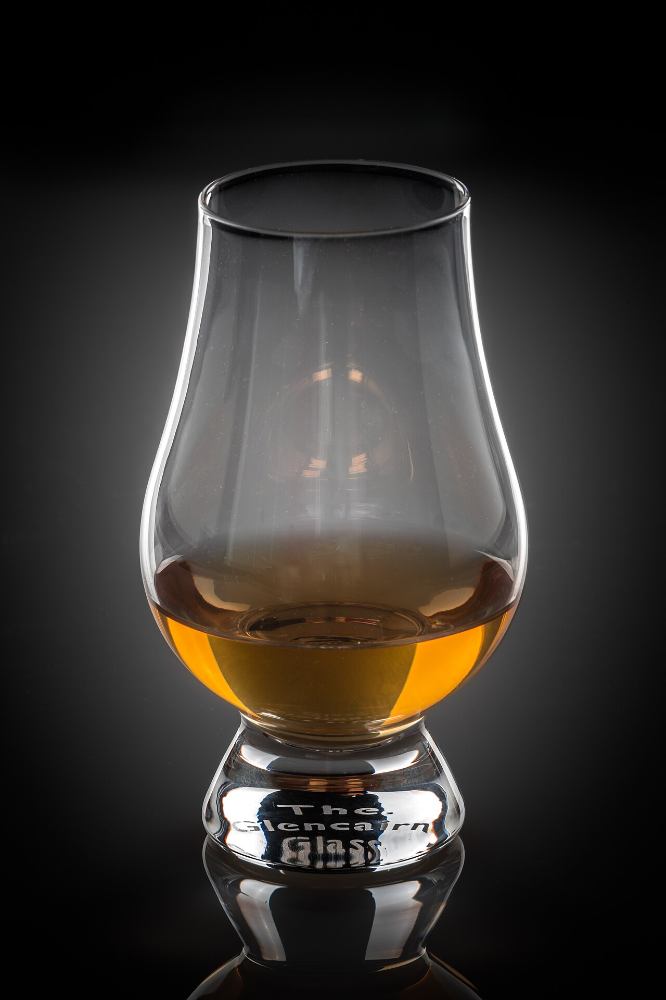

# 威士忌闻香杯

威士忌闻香杯是一种小型品鉴杯：杯腹像郁金香，杯口收窄，底座短而厚。它的形状不是装饰，而是为了把威士忌的香气聚到杯口，让闻香更集中、更有层次。

最广为人知的是格兰凯恩杯（Glencairn glass）。它由苏格兰格兰凯恩水晶公司在 2000 年代初设计，灵感来自传统的威士忌品鉴杯与西班牙的 copita。它的出现，让“闻香”从专业品鉴室走进了普通酒吧与家庭。关于威士忌本身，可以参考[威士忌](ref:whisky)。

图：一只格兰凯恩闻香杯。图片：Pjt56，CC BY-SA 4.0，via Wikimedia Commons（[原图页面](https://commons.wikimedia.org/wiki/File:Glencairn_Glass-pjt.jpg)）。

## 器型与比例

闻香杯的核心比例是“郁金香形杯腹、收窄杯口、短厚底座”。杯腹下部宽，能让酒液接触空气；上部收，能把香气导向杯口；杯口窄，能减少香气向四周散失。

杯子的容量通常不大，倒入 20 到 30 毫升即可。酒液太多，香气会过于浓烈，酒精感压过细节；酒液太少，香气不足，杯腹的空腔又会让香气散掉。少量、多次，是闻香杯的使用节奏。

短厚的底座让杯子更稳，也方便掌心托杯。手掌的温度能轻微加热酒液，让香气更容易释放；但托杯时间过长，酒精感也会增强，需要自己掌握。

## 为什么要收口

威士忌的香气来自酒精、酯类、酚类、醛类与橡木 extractives。杯口敞开，香气会向四周扩散，闻到的只是“酒精与甜味”；杯口收窄，香气被导向鼻前，才能分辨泥煤、香草、柑橘、蜂蜜与木质。

收口也会改变酒精的刺激。杯口太窄，酒精感会集中在鼻腔，显得刺鼻；杯口略宽，香气更柔和，但集中度下降。闻香杯的设计，是在“集中”与“刺激”之间找平衡。

不同威士忌适合不同杯型。泥煤味重的威士忌，收口杯能让烟熏与海盐更清晰；花香型威士忌，略宽的杯口能让细腻香气展开；高酒精度威士忌，收口杯会放大酒精，需要加一点水。

闻香杯与 copita 的区别也值得注意。copita 的杯口更宽、杯腹更浅，适合西班牙雪莉酒的品鉴；闻香杯的杯口更窄、杯腹更深，更适合威士忌的复杂香气。两者都能聚香，但聚香的程度不同。选杯时可以用同一款酒对比，感受杯口宽窄对香气的影响。杯口越窄，香气越集中，酒精也越突出；杯口略宽，香气展开，但聚香减弱。杯壁的厚度也有影响：薄壁让温度更快接近手温，厚壁则更稳。

## 适合什么酒

闻香杯最适合威士忌的纯饮与品鉴，尤其是单一麦芽、单一桶与高年份威士忌。它也适合其他烈酒的闻香，例如干邑、雅文邑、朗姆酒与陈年龙舌兰；只要是需要“闻香”的酒，都可以用。

它不适合加冰大量饮用。冰块会占空间，收口杯也不方便放入大冰；如果要加冰，古典杯或 rocks 杯更合适。它也不适合鸡尾酒，尤其是带果汁、奶油或气泡的饮品。

如果只有一种杯子，闻香杯可以作为“品鉴杯”，古典杯可以作为“饮用杯”。两者分工不同：闻香杯负责细节，古典杯负责舒适。

## 温度与闻香

威士忌通常在室温下饮用，约 18 到 20 摄氏度。温度太低，香气被压住；温度太高，酒精感突出，香气变得刺鼻。不要加热闻香杯，也不要把杯子放在暖气旁。

闻香时先静置几秒，让酒液稳定；然后把杯口靠近鼻尖，轻吸一口气，不要深吸。深吸会让酒精刺激鼻腔，反而闻不到细节；短促、轻缓的吸气，更容易分辨香气层次。

加水的量要少。几滴室温清水就能让高酒精度威士忌的香气打开；加太多，酒体会变薄，香气也会散。关于闻香的方法，可以参考[闻香](ref:nosing)。

## 持杯与清洗

持杯时握住杯底或杯腹下部。掌心托杯可以轻微加热酒液，但时间不要太长；手指不要伸进杯口，以免影响香气与卫生。

清洗时用温水和少量中性洗涤剂，充分冲洗，倒扣晾干。闻香杯的杯口窄，杯底容易残留洗涤剂；冲洗时要多冲几遍，确认没有泡沫与气味。

存放威士忌闻香杯时避免与有强烈气味的物品放在一起。玻璃会吸附气味，尤其是长期不用的杯子；使用前可以用清水冲一遍并晾干。关于选杯的更多原则，可以参考[如何选杯](ref:glass)。

## 常见误区

第一，倒得太满。闻香杯只需要少量酒液，倒满会让香气过浓，酒精感压过细节。

第二，深吸猛闻。深吸会让酒精刺激鼻腔，反而闻不到香气；轻缓短促的吸气更有效。

第三，用闻香杯加冰。冰块占空间，收口杯也不方便放大冰；加冰饮用应改用古典杯。

第四，认为闻香杯越贵越好。杯型、杯口与清洗状态比价格更重要；一只干净的普通闻香杯，胜过一个有气味的高价杯。关于其他烈酒杯型，可以参考[雪莉小杯](ref:copita)与[白兰地杯](ref:snifter)。

对照阅读：[威士忌](ref:whisky)、[白兰地杯](ref:snifter)。

相关条目：[雪莉小杯](ref:copita)。

**关键事实。**

| 项目 | 内容 |
| --- | --- |
| 一句话定位 | 杯腹呈郁金香形、杯口收窄的小型品鉴杯，用于威士忌闻香与少量品饮；收口聚香，短底座便于掌心托杯 |
| 材质 | 玻璃、水晶玻璃 |
| 适用 | 威士忌闻香、少量纯饮、其他烈酒品鉴 |

**来源与边界。** 本页关于「威士忌闻香杯」的关键事实，主要由以下来源交叉核对：Oxford University Press（威士忌品鉴、闻香与杯型背景）、Encyclopaedia Britannica（威士忌品类与品鉴的一般背景）、Corning Museum of Glass（玻璃器型与工艺背景）等 5 条来源。价格、批次与状态会变，涉及这些字段时以页面所列来源的最新版本为准。正文为项目自写，来源只作核验，不复制原文。

**并读。** 把「威士忌闻香杯」与「威士忌」、「雪莉小杯」、「白兰地杯」放在一起读时，先确认它们是同一层级还是上下游关系：先确认杯型用途与材质，再比较容量、杯口与香气表现。本页负责给出器皿的基本坐标，对照条目补上具体案例与差异；读完再回到本页，才能分清哪些差别属于器皿本身，哪些只是产地、批次或品牌选择。

**适用边界。** 对「威士忌闻香杯」而言，容量与杯型会因生产商不同；杯口、杯腹与材质比“专用杯”标签更重要。

**更新提示。** 「威士忌闻香杯」最近核对于 2026-11-20；尺寸、材质、容量与替代品会变，购买前以厂商规格为准。

**编者注。** 本页把「威士忌闻香杯」作为器皿条目处理：定义、流程与关键数字以正文表格为准，与「威士忌」、「雪莉小杯」的差异用对照阅读验证；遇到价格、批次或地址，回到页面所列来源核对。
