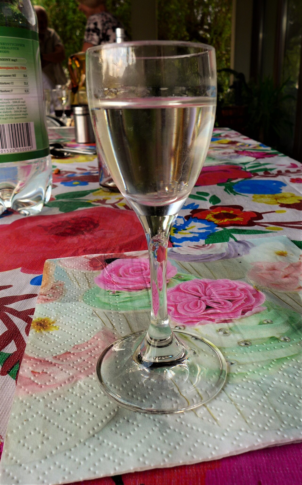

# 白葡萄酒杯

白葡萄酒杯比红酒杯小一号。它的杯腹更窄、杯口更收、杯梗通常更短，目的不是“省材料”，而是控制氧化：白葡萄酒的香气更轻、酸度更突出，过多的空气会让花香与果香迅速散失。

同样叫白葡萄酒杯，也有不同形状。霞多丽杯杯腹略宽，适合饱满型白葡萄酒；长相思、雷司令杯更窄，适合清爽、酸度高的酒。杯型的选择，取决于酒的香气与酸度，而不是颜色。

图：一杯白葡萄酒。图片：BogTar201213，CC BY-SA 4.0，via Wikimedia Commons（[原图页面](https://commons.wikimedia.org/wiki/File:A_glass_of_white_wine.jpg)）。

## 器型与比例

白葡萄酒杯的核心比例是“小杯腹、窄杯口、适中杯梗”。杯腹容量通常在 250 到 350 毫升，倒酒约占三分之一到四分之一；杯腹小，酒液与空气接触少，香气更集中。

杯口收窄，能保留花香与柑橘香。杯口过宽，香气会迅速散失；杯口过窄，酒精感会突出，酸度显得尖锐。收口的弧度要与杯腹配合，不能只看杯口大小。

杯梗的长度通常比红酒杯短，但仍要足够让手指握住。短梗更稳，适合餐桌与日常使用；长梗更优雅，适合正式品鉴。两者没有绝对优劣，取决于使用场景。

## 为什么杯腹更小

白葡萄酒的香气以花香、柑橘、青苹果、矿物为主，这些香气挥发性强，容易被空气带走。杯腹小，酒液表面积小，香气释放慢，能在杯中维持更久；杯口收，香气集中，入口前还能闻到。

白葡萄酒的酸度通常更高，温度也更低。小杯腹能让酒液更快达到饮用温度，也能减少手部传热；大杯腹在低温下容易让香气“闷住”，喝起来显得平淡。

白葡萄酒不需要像红酒那样“打开”。它的香气通常已经外放，过度的空气会让它变平；因此，小杯不是“限制”，而是“保护”。

甜酒与起泡酒需要另作考虑。贵腐酒、冰酒适合更小的杯子，以集中香气并控制温度；香槟与其他气泡酒则需要细长杯身来保留气泡，白葡萄酒杯的宽口并不合适。选杯时先看酒的类型，再看杯子的形状。日常使用中，白葡萄酒杯也可以装水或清淡的茶，但不要用来装热饮，薄壁经不起骤热。

## 适合什么酒

白葡萄酒杯适合清爽型、芳香型与饱满型白葡萄酒。长相思、雷司令、阿尔巴利诺适合较窄的杯型；霞多丽、白诗南、维欧尼适合略宽的杯型；甜酒与贵腐酒则适合更小的杯型，以集中香气。

它不适合红葡萄酒。红葡萄酒的单宁与香气需要更大的杯腹与更多的空气；用白葡萄酒杯喝红酒，香气会显得拥挤，单宁也会更涩。

它也不适合香槟。香槟需要细长杯身来保留气泡，白葡萄酒杯的杯口仍偏宽，气泡会较快散失。起泡酒应使用香槟笛杯或郁金香杯。

## 温度与倒酒

白葡萄酒的饮用温度通常在 8 到 12 摄氏度，清爽型偏低，饱满型偏高。温度太低，香气被压住；温度太高，酸度显得松散，酒精感突出。关于温度控制，可以参考[加冰与温度](ref:ice)；关于白葡萄酒本身，可以参考[白葡萄酒](ref:white)。

倒酒倒到杯腹的三分之一左右。倒得太满，香气没有空间，杯壁也容易留下指纹；倒得太少，酒液表面积不足，香气释放慢。低温酒可以少倒一点，喝完后再次添加，避免回温。

倒酒沿杯壁缓慢注入，避免直接冲击杯底。白葡萄酒通常没有沉淀，但冲击仍会让香气过度挥发；沿壁倒酒更温和，也更容易控制分量。

## 持杯与清洗

持杯时握住杯梗或杯脚，不要握住杯腹。白葡萄酒温度低，手的温度会很快传给酒液，让酒在几分钟内升温；杯腹上的指纹也会影响观感。

清洗时用温水和少量中性洗涤剂，充分冲洗，倒扣晾干。白葡萄酒杯的杯口较窄，杯底容易残留洗涤剂；冲洗时要多冲几遍，确认没有泡沫与气味。

存放白葡萄酒杯时避免与有强烈气味的物品放在一起。玻璃会吸附气味，长期不用的杯子在使用前可以用清水冲一遍并晾干。关于选杯的更多原则，可以参考[如何选杯](ref:glass)。

## 常见误区

第一，用红酒杯喝白葡萄酒。大杯腹会让香气过度氧化，白葡萄酒会显得平淡；白葡萄酒需要更小的杯腹与更收的杯口。

第二，倒酒倒满。满杯没有香气空间，低温酒也容易回温；三分之一左右才是合适的起点。

第三，把杯子放进冰箱冷冻。骤冷会让玻璃产生应力，杯口也可能结霜；冷藏酒液即可，杯子不必冷冻。

第四，认为白葡萄酒杯越小越好。杯腹过小，香气展不开，酸度显得尖锐；杯型要与酒体匹配。关于红酒的杯型，可以参考[红酒杯](ref:red)；关于收口杯的香气逻辑，可以参考[郁金香杯](ref:tulip)。

对照阅读：[白葡萄酒](ref:white)、[郁金香杯](ref:tulip)。

相关条目：[红酒杯](ref:red)。

**关键事实。**

| 项目 | 内容 |
| --- | --- |
| 一句话定位 | 杯腹较小、杯口收窄的带梗酒杯，用于白葡萄酒；较小的杯腹限制氧化，收口保留花香与酸度，适合低温饮用 |
| 材质 | 玻璃、水晶玻璃 |
| 适用 | 白葡萄酒、清爽型起泡酒以外的浅色酒款 |

**来源与边界。** 本页关于「白葡萄酒杯」的关键事实，主要由以下来源交叉核对：Oxford University Press（酒杯形制、香气与品鉴背景）、Encyclopaedia Britannica（葡萄酒品鉴与侍酒的一般背景）、Corning Museum of Glass（玻璃器型与工艺背景）等 5 条来源。价格、批次与状态会变，涉及这些字段时以页面所列来源的最新版本为准。正文为项目自写，来源只作核验，不复制原文。

**并读。** 把「白葡萄酒杯」与「白葡萄酒」、「红酒杯」、「郁金香杯」放在一起读时，先确认它们是同一层级还是上下游关系：先确认杯型用途与材质，再比较容量、杯口与香气表现。本页负责给出器皿的基本坐标，对照条目补上具体案例与差异；读完再回到本页，才能分清哪些差别属于器皿本身，哪些只是产地、批次或品牌选择。

**适用边界。** 对「白葡萄酒杯」而言，容量与杯型会因生产商不同；杯口、杯腹与材质比“专用杯”标签更重要。

**更新提示。** 「白葡萄酒杯」最近核对于 2026-11-20；尺寸、材质、容量与替代品会变，购买前以厂商规格为准。

**编者注。** 本页把「白葡萄酒杯」作为器皿条目处理：定义、流程与关键数字以正文表格为准，与「白葡萄酒」、「红酒杯」的差异用对照阅读验证；遇到价格、批次或地址，回到页面所列来源核对。
